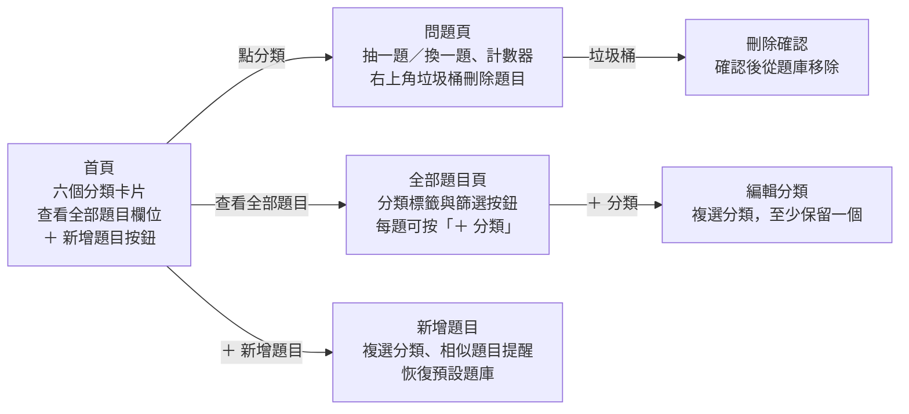

Readme · MD
# 💬 隨機破冰問題產生器
 
在聚會、約會或初次見面時，依分類快速抽出聊天話題，並能自行管理題庫的單頁互動網頁。
 
🔗 **線上試玩**： https://yucihl.github.io/life-questions/
 
---
 
## 一、專案概述
 
| 項目 | 內容 |
| --- | --- |
| 專案名稱 | 隨機破冰問題產生器 |
| 目的 | 快速提供聊天話題，降低冷場 |
| 使用情境 | 手機或電腦開啟網頁，選分類後抽題，大家輪流回答 |
| 交付檔案 | 單一 `index.html`（CSS 與 JavaScript 內嵌） |
| 發布方式 | GitHub Pages 公開網址 |
| 開發方式 | Vibe coding，依本規格書分階段完成 |
 
## 二、頁面架構
 
網頁共三個主要畫面與三個彈出視窗，全部在同一個 `index.html` 中切換。
 

 
所有功能都從首頁進入；問題頁與全部題目頁左上角皆有返回按鈕，彈出視窗可按取消、點背景或按 Esc 關閉。
 
## 三、功能規格
 
### 3.1 分類與抽題
 
- 共六個入口：初次見面、朋友、情侶、深度聊天、搞笑、隨機抽取。
- 「隨機抽取」從全部題目中抽，被放在多個分類的題目只算一次。
- 進入分類時先洗牌，依序抽出；整個分類抽完一輪才重新洗牌。
- 重新洗牌時顯示提示「這輪抽完了，重新洗牌囉！」，且新一輪第一題不會與上一題相同。
- 按鈕在尚未抽題時顯示「抽一題」，抽過後顯示「換一題」。
- 換題時題目卡片播放翻牌動畫。
### 3.2 計數器
 
- 顯示「已抽 X / Y 題」，Y 為該分類目前總題數。
- 下方進度條同步顯示本輪進度，重新洗牌後歸零。
### 3.3 刪除題目
 
- 問題頁右上角的垃圾桶圖示可刪除目前顯示的題目，尚未抽題時為停用狀態。
- 刪除前跳出確認視窗，顯示題目內容。
- 刪除後該題從題庫完全移除（包含所有分類），並自動顯示下一題。
- 分類題目被刪光時，顯示「這個分類沒有題目了，去新增一些吧！」與新增按鈕。
### 3.4 新增題目
 
- 從首頁「＋ 新增題目」開啟視窗，輸入題目（上限 100 字）並複選分類。
- 驗證規則：題目不可空白、至少選一個分類、完全相同的題目不可重複加入。
- 新增成功後顯示提示「已新增到：（分類名稱）」，首頁題數同步更新。
### 3.5 相似題目提醒
 
- 輸入題目時即時比對題庫，於輸入框下方列出最多 3 題可能重複的題目。
- 相同的關鍵字以黃色標示，並列出「相同關鍵字」標籤。
- 比對方式：將句子切成兩字一組比對，相鄰的相同詞合併為較長關鍵字。
- 自動忽略「什麼」「如果」等常用詞，以及出現在超過 12% 題目中的詞。
- 僅作提醒，不阻擋新增；完全相同的題目則標示「這題已經存在題庫中」。
### 3.6 查看全部題目
 
- 首頁「查看全部題目」欄位顯示總題數，點入後列出所有題目。
- 每題下方顯示所屬分類標籤（圖示加名稱）。
- 上方篩選按鈕可切換「全部」或單一分類，並顯示該分類題數。
- 每題右下角「＋ 分類」按鈕可開啟編輯視窗，勾選或取消分類；每題至少需保留一個分類。
- 儲存後提示「已加入：（分類名稱）」，首頁各分類題數同步更新。
### 3.7 恢復預設題庫
 
- 新增題目視窗底部的「恢復預設題庫」連結，經確認後清除自訂題目並還原 50 題預設題庫。
## 四、題庫與資料儲存
 
預設題庫共 50 題，五個分類各 10 題；使用者的新增、刪除與分類修改存在自己的瀏覽器中。
 
### 4.1 預設題庫範例
 
| 分類 | 題數 | 範例題目 |
| --- | --- | --- |
| 初次見面 | 10 | 如果可以免費去任何國家，你會去哪裡？ |
| 朋友 | 10 | 你做過最衝動的一件事是什麼？ |
| 情侶 | 10 | 你第一次注意到我是什麼時候？ |
| 深度聊天 | 10 | 有什麼想法是你這幾年改變最多的？ |
| 搞笑 | 10 | 如果能擁有一種超能力，但只能用在很無聊的地方，你會選什麼？ |
 
預設題目寫在 `index.html` 的「預設題庫」區塊（搜尋「★ 預設題庫 ★」），修改後重新上傳 GitHub，所有訪客都會看到新版本。
 
### 4.2 資料結構
 
每一題的格式為 `{ id, text, cats }`：`id` 為唯一編號，`text` 為題目文字，`cats` 為所屬分類陣列，可包含多個分類。
 
### 4.3 儲存方式與限制
 
- 使用瀏覽器 localStorage 儲存，重新整理後資料仍保留。
- 資料只存在目前的裝置與瀏覽器：換裝置、換瀏覽器或清除網站資料後會回到預設題庫。
- 每位訪客各自擁有一份題庫，彼此看不到對方的修改。
- 若瀏覽器無法使用 localStorage（例如無痕模式限制），網頁仍可正常操作，只是不會保留修改。
## 五、視覺設計
 
整體採柔和莫蘭迪淺色系，低飽和度、圓角卡片與柔和陰影，營造輕鬆不壓迫的聊天氛圍。
 
### 5.1 分類配色與圖示
 
| 分類 | 圖示 | 代表色 | 色碼 |
| --- | --- | --- | --- |
| 初次見面 | 👋 | 霧藍 | `#A3B5C7` |
| 朋友 | 🤝 | 灰綠 | `#A8B8A0` |
| 情侶 | 💕 | 乾燥玫瑰 | `#D4A5A5` |
| 深度聊天 | 🌙 | 灰紫 | `#B5A8C2` |
| 搞笑 | 😂 | 奶茶黃 | `#D9C4A0` |
| 隨機抽取 | 🎲 | 暖灰 | `#BFB5AA` |
 
### 5.2 基礎色
 
| 用途 | 色碼 |
| --- | --- |
| 頁面底色（米白） | `#F5F1EC` |
| 卡片底色 | `#FBF9F6` |
| 主要文字（深灰褐） | `#5E544B` |
| 次要文字 | `#9A8F84` |
| 刪除警示（柔和紅） | `#C98B85` |
 
### 5.3 版面與動畫
 
- 首頁分類為兩欄三列：初次見面、朋友／情侶、深度聊天／搞笑、隨機抽取。
- 進入問題頁後，按鈕、進度條與卡片上緣會換成該分類的代表色。
- 畫面切換使用淡入動畫，換題使用翻牌動畫，提示訊息從底部淡入。
- 版面最大寬度 480px，置中顯示；手機與電腦皆適用，按鈕大小適合手指點擊。
- 文字使用系統中文字體（蘋方、微軟正黑體、Noto Sans TC）。
## 六、技術規格與部署
 
- 單一檔案 `index.html`，HTML、CSS、JavaScript 全部內嵌。
- 不使用任何外部框架、函式庫或網路字型，下載後雙擊即可在瀏覽器離線開啟。
- 三個畫面（首頁、問題頁、全部題目頁）在同一頁面以顯示切換，不需換頁。
- 視窗類元件（新增題目、編輯分類、確認）以彈出層呈現，可點背景或按 Esc 關閉。
- 使用者輸入的文字一律以純文字顯示，避免插入 HTML 造成問題。
- 部署：將 `index.html` 上傳至 GitHub 儲存庫，於 Settings → Pages 開啟 GitHub Pages，取得公開網址。
## 七、驗收標準
 
- [ ] 開啟 index.html 能正常顯示首頁
- [ ] 首頁分類為兩欄三列，「隨機抽取」位於「搞笑」旁邊
- [ ] 六個分類都能進入並抽題，題目符合分類
- [ ] 同一分類抽完一輪才重複，計數器與進度條正確
- [ ] 能新增題目並複選分類，重新整理後仍存在
- [ ] 輸入題目時會即時顯示可能重複的題目與相同關鍵字
- [ ] 能刪除題目，且刪除前有確認提示
- [ ] 「查看全部題目」能列出所有題目、顯示分類標籤並依分類篩選
- [ ] 能從全部題目頁將題目加入或移出其他分類
- [ ] 「恢復預設題庫」可正常運作
- [ ] 手機畫面不跑版
- [ ] 部署到 GitHub Pages 後可透過網址公開瀏覽
 
Claude finished the response
